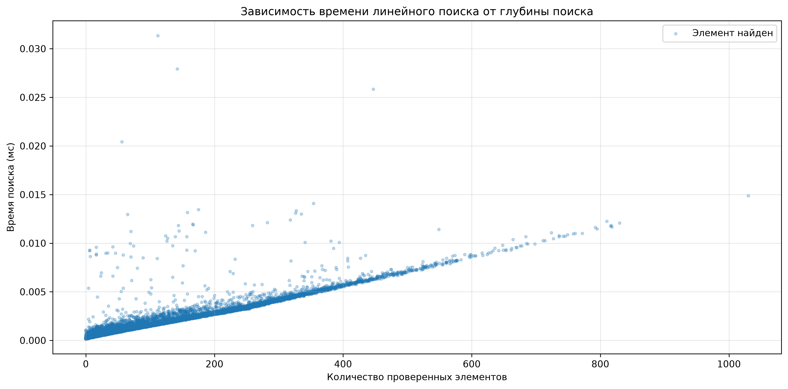

# Домашнее задание Synergy

## Реализация линейного поиска на Python

Перед запуском программы необходимо установить библиотеку **Matplotlib**:

```bash
pip install matplotlib
```

Данный скрипт демонстрирует работу функции линейного поиска:

```python
def find_index(arr, n):
    for i in range(len(arr)):
        if arr[i] == n:
            return i
    return -1
```

Алгоритм последовательно перебирает элементы списка, сравнивая каждый из них с искомым значением.

Если элемент найден, функция возвращает индекс его первого вхождения, после чего поиск прекращается. Если элемент отсутствует, алгоритм проверяет весь список и возвращает `-1`.

## Временная сложность алгоритма

Для исследования производительности было проведено **20 000 запусков линейного поиска** значения `50` в случайно сгенерированных списках по 10 000 элементов. Каждый элемент принимал случайное значение от 0 до 100.

В качестве параметров графика были выбраны:

- **Ось X** — позиция найденного элемента (индекс).
- **Ось Y** — время выполнения поиска в миллисекундах.

Такой подход позволяет исследовать зависимость времени выполнения от расположения искомого элемента, а не только от общего размера списка.

Например, если искомый элемент находится в начале списка, алгоритм завершит работу практически сразу, независимо от того, содержит список 100 или 10 000 элементов.

При этом чем дальше расположен искомый элемент, тем больше сравнений необходимо выполнить.

В случае отсутствия элемента алгоритм проходит весь список, выполняя максимальное количество сравнений.

### Вывод

Временная сложность линейного поиска составляет:

- **Лучший случай — O(1):** искомый элемент находится в начале списка.
- **Средний случай — O(n):** количество проверяемых элементов в среднем растёт пропорционально длине списка при стандартных предположениях о расположении искомого элемента.
- **Худший случай — O(n):** элемент находится в конце списка или отсутствует.

Таким образом, результаты эксперимента позволяют исследовать зависимость времени выполнения от количества проверенных элементов, а анализ алгоритма подтверждает его линейную временную сложность **O(n)**.

